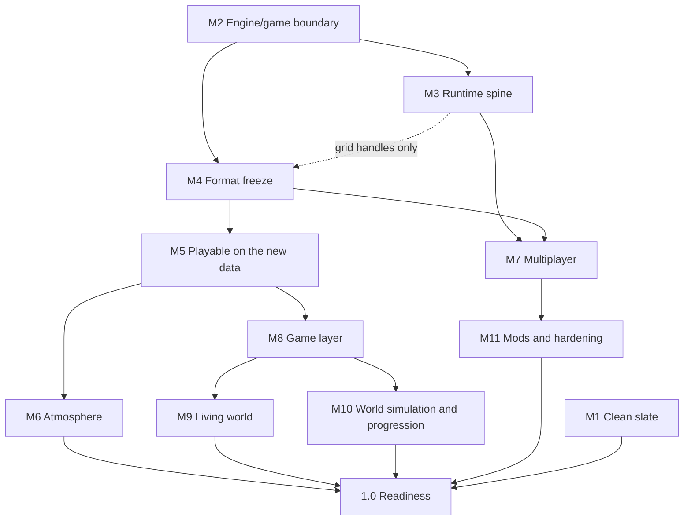

# Voxulacrum Engine Roadmap — 0.4.0 through 1.0

**Status:** Authoritative planning reference, v2.2
**Companions:** `engine-design.md` (v1.13 — foundational data model and architecture), `target-architecture.md` and `migration-plan.md` (October 2026 design review; the source of the v2.0 decisions), `networking-architecture-proposal.md` (PROPOSAL until the networking work completes), `underground-visibility-design.md`, phase audits, `architecture-drift-review.md`, `engine-architecture-reference.md` (external review — disposition recorded in §21).
**Tracker:** every work item is a GitHub issue, grouped by [milestone](https://github.com/BananaPix4613/voxulacrum/milestones) and tracked on the *Voxulacrum engine* project board (§9.3).
**Purpose:** Make the technical goals visible, fix the working discipline, and sequence every core capability the engine needs before it is a *ready product* — an engine another person (or future you) can build a title on without engine surgery.

**What 1.0 means.** Not "a demo shipped." 1.0 is defined by the **readiness rubric in §5** — measurable criteria across eleven domains. The MVT — a co-op multiplayer voxel survival sandbox — is the *evidence* that the rubric passes, not the definition of readiness. An engine that can ship exactly one title and nothing else is not at 1.0.

**What changed in v2.0.** The version ladder is gone. Work is planned as workstreams of small items with explicit dependencies, grouped into milestones, and a version number is cut only when a milestone completes or compatibility changes (§1, §7, §9). Work items live as GitHub issues (§9.3). Branches are short and per work item (§7.5). Pillars P8 and P9 are revised and P15–P19 are added (§2). Forcing-date decisions D1–D8 are settled except D6 (§8).

---

## 1. How to use this document

This document exists because two sprints drifted, in different ways.

0.2.0 drifted in scope. Its stated core shipped complete, but time went to side tangents that were never in scope, an unscoped feature went in at the last minute and shipped with an undiagnosed defect, and the release itself was never assembled (`Cargo.toml` at 0.1.1, a frozen changelog, no tags).

0.4.0 drifted in shape. Its theme was met, but it lived on a single long branch that kept absorbing work, and the work it absorbed was increasingly game asset work (making trees look right) rather than engine work. The version-per-branch rule turned a version into a container for everything happening at the time, and the version ladder turned "what should I build next?" into "what did the plan assign to this number?", even where the order was arbitrary.

The rules below are the countermeasure. Rules 1 to 3 replace the ladder; the rest carry over.

1. **Work is organized as workstreams of small work items.** A workstream is a long-lived area of the engine (§9.1). A work item is the unit of work: one item, one branch, sized S (under 500 changed lines), M (500 to 2,000) or L. An L item is split before it starts.
2. **Dependencies are explicit and only recorded where they are real.** "The binary mesher needs occupancy masks" is an edge; "audio comes after lighting" is not. Anything unblocked may be picked in any order.
3. **Milestones are named capability sets with exit gates, not dates or numbers.** They may overlap. A milestone is broken into work items only when it is near: M1 to M5 are, and M6 to M11 each have one placeholder issue and stay at the level of §12 until they are next.
4. **Exit gates are checklists, not vibes.** A milestone completes when its gates pass. A dropped gate is a scope decision recorded in the changelog, never a silent omission.
5. **Debt is scheduled, not ambient.** Every known defect and interim shape is an issue in a workstream. New debt either joins the current milestone (if it blocks a gate) or gets an issue before the next release is cut.
6. **Every item ships tooling for what it builds.** A feature without an authoring path, a preview, and a diagnostic is half-built (§4).
7. **Forcing-date decisions get decided, not deferred by silence.** §8 lists architectural choices whose cost rises sharply at a specific milestone. Each is decided before that milestone starts, in writing, with reasons.
8. **Docs are part of the release.** A release is not done until: workspace version bumped, `CHANGELOG.md` entry written, close-of-milestone audit exists, newly-settled architecture folded into `engine-design.md`.
9. **Every branch serves one work item.** A branch serving no item is a tangent by definition; give it an issue or drop it. Its pull request closes the item's issue (`Fixes #n`). Game and asset work belongs to the game repository, not to an engine branch.

---

## 2. Technical pillars — the stakes in the ground

Properties that must hold at any scale of game derived from this engine. Every milestone must strengthen these or leave them intact.

**P1 — Determinism in generation, divergence-tolerance in simulation.** Same seed + graphs + parameters + coordinates → bit-identical terrain on one machine; hash-verified self-healing terrain across machines. Simulation is *not* lockstep-deterministic; the server owns it, clients render replicated state. Every generation pass ships with a determinism test.

**P2 — The graph is the world generator; the manifest is the resolution root.** All world content flows from authored graphs + registries. Editing the active graph edits the live world. No system hardcodes content identity — materials, prefabs, palettes, sounds all resolve through registries.

**P3 — Changes localize.** The world is infinite; every system is per-chunk or per-column, tolerates chunks appearing/disappearing any frame, and invalidates by tag lookup — never world scan. Cost scales with the observed set, not the world.

**P4 — The generated/authored split is the save format AND the wire format.** Persistent state is the delta from generated output; generation is reproducible from recorded inputs. Save files stay small, network payloads stay small, and the persistence encoders *are* the wire encoding. One serialization discipline.

**P5 — One mutation door.** Every world write — editor, player tool, hot-reload, network command, game script, region transformation — goes through the mutation command API with a declared origin and mode. The door is where validation, mode enforcement, persistence marking, mesh invalidation, event emission, and network broadcast live. A write path that bypasses the door is a bug by definition.

**P6 — The client/server boundary is compiler-enforced.** From M3 (runtime spine), simulation/generation/persistence/mutation live in a crate with no renderer types. Single-player is the client talking to an embedded core over loopback — one code path, not two.

**P7 — Data shapes are settled; implementations are incremental; interim shapes are recorded.** Any divergence between target and implementation is written down with a named migration trigger. Silent drift is the failure mode.

**P8 — No head-on views (the default camera).** *(Revised v2.1.)* The engine's isometric camera module, which the samples and the testbed start with, keeps its resting views showing three faces of an axis-aligned block: a top and two sides. A view straight along a world axis collapses blocks into flat two-face shapes and removes the depth an isometric game depends on. The rule covers that camera's resting views, not objects (a rotating ship may briefly face the camera) and not transitions (an eased 90° rotation passes through head-on angles for a frame or two). It is a rule of the camera module, not of the engine: a game that brings its own camera, perspective or otherwise, is not bound by it (P20). What stays engine-wide is the voxel format: the world's voxel geometry is axis-aligned cubes only, while models, entities and dynamic grids may take any shape or rotation. Pixel-perfect snapping and quantized light are per-game presentation choices (P19).

**P9 — One renderer, authoring in the engine.** *(Revised v2.0.)* Authoring stays inside the engine, on its one renderer, as a loop (P11). The editor is its own binary built on the engine library, and playtesting a game or mod launches it as a separate process the editor attaches to over a debug protocol. The original "one binary" form would put game code back inside the engine once games live in their own repositories. (The headless server binary is server-core, not a second engine.)

**P10 — Performance is budgeted, not aspirational.** Budgets (§7.3) tracked via in-engine instrumentation, gating from M5. An unexplained frame hitch is a release blocker. The minimum spec is declared now rather than at the end: 6 to 8 CPU cores with integrated graphics, holding 30 fps at reduced settings.

**P11 — Authoring is a loop, not a build step.** Every authorable thing is editable in-engine, previewable before commitment, and hot-reloadable without restart. The measure is round-trip time: change → see result. If an author must restart the engine, edit a file by hand, or guess at a result, that content type's tooling is incomplete. (0.2.0's caves were hand-authored in raw graph JSON off-session. That is the failure state this pillar prevents.)

**P12 — Every engine capability has a game-facing API.** A capability the engine "has" but that a game feature cannot call is not delivered. Each subsystem in §6 exposes a stable, documented surface usable from game code without reaching into engine internals — and that surface is what the compatibility promises (§7.2) protect.

**P13 — Visibility is queryable world state, not a rendering effect.** *(Added v1.2, from the external review — the sharpest architectural correction it offered.)* Whenever the engine hides geometry — underground visibility, future slice modes, occlusion fades — the decision lives in world state that the renderer, the interaction system, and any other consumer all read from the same place. If the renderer hides a ceiling but the raycaster still collides with it, players target blocks they cannot see and the game feels broken in ways they cannot articulate. This rules out occlusion implemented purely in shaders. The engine's air-side face rule already computes a real classification; the pillar requires that classification be *shared*, not re-derived or ignored by non-rendering consumers.

**P14 — One scheduler, one clock family.** All deferred and background work — generation, meshing, lighting, pathfinding, structures, chunk I/O, region transformation, simulation ticks — runs on a single job system with declared dependencies and priorities, and all periodic simulation derives from one tick framework rather than per-system ad-hoc clocks. Two schedulers means two tuning surfaces that must agree by hand and never do.

**P15 — Mechanism in the engine, policy in the game.** *(Added v2.0.)* The engine never hardcodes a material, channel, controller constant or creature. It provides registries, traits and data formats; games register content and rules into them.

**P16 — The game is the first package.** *(Added v2.0.)* The prototype game lives in its own repository and loads through the same facade crate and package format a mod would use, with no privileged access. Every time it needs to reach past the facade, the facade is missing something.

**P17 — Authoritative data and derived data are separate.** *(Added v2.0.)* Meshes, light textures, GPU acceleration structures and LOD are caches rebuilt from world data at any time, including after a GPU device loss. No system treats a derived cache as truth.

**P18 — Never delete data you don't understand.** *(Added v2.0.)* Content from a missing or disabled package loads as placeholders and opaque blobs that keep their original identity, and is restored when the package returns.

**P19 — No house style.** *(Added v2.0.)* Pixel-perfect snapping, palette quantization, outlines, texel-locked resolution and the lighting model are presentation settings a game chooses, never assumptions another engine system depends on. Strict pixel art, textured 3D with pixel-art textures, and hybrids are presets over one pipeline.

**P20 — The core makes no camera assumption.** *(Added v2.1.)* Core systems (streaming, culling, level of detail, shadows, picking, audio) take a camera description as input: view, projection, frustum and an area of interest. Isometric framing, orthographic projection, texel snapping, 90° rotation steps, cutaway and floor-anchored follow belong to the isometric camera module in the kit, which games may use or replace. The testbed runs a perspective camera beside the isometric one to keep this true.

---

## 3. State of the engine at 0.4.0

The full current-versus-target comparison lives in the gap map in `migration-plan.md`. This is the summary that sequencing depends on.

**Settled and carried forward.** The mutation door with origin and mode gates; overrides-only persistence with deterministic encoders; deterministic node-graph generation with world-absolute seeding, the margin-band feature model and CI determinism checks; palette-compressed cubic chunks with copy-on-write storage; one job scheduler with `(class, distance)` priority; the pure fixed-step player step; the world event bus; the in-engine diagnostics suite; the presentation core (texel-snapped projection, palette and outline passes, shader hot reload).

**Known defects** (F1–F4, issues #1–#4): edits are lost after a chunk is promoted to a full save; a zstd dictionary trained mid-session breaks streaming loads; fluid capacity arithmetic can underflow and mass is not conserved across seams; one CI test (tree capsule taper) fails by a single float rounding step.

**Interim shapes with a named destination.**

| Interim shape | Destination |
| --- | --- |
| 1 m voxels with a 4-shape vocabulary | 0.5 m voxels with two-level storage (§8 D1, M4) |
| Numeric registry IDs on disk; the material table defined in three places | One RON table now (F5); string identity with per-save mapping (§8 D5, M4) |
| Monolithic blob version with wipe-on-bump | Per-layer versioning (M4) |
| Fluid persisted as a full snapshot | Diff with tombstones (M4) |
| Three ad-hoc clocks on wall-clock `dt` | One 30 Hz tick framework (M3) |
| One binary crate holding engine, content wiring and editor | Facade crate, game repository, editor binary (M2) |
| Simulation and rendering in one schedule run on the main thread | Server-core crate and a render world filled by an extract step (M3) |
| Naive face meshing with 32-byte vertices, per-chunk draws | Binary greedy meshing, buffer arena, indirect draws (M5) |
| Fixed per-axis brightness tied to world axes | Selectable lighting models (M5) |

**The engine/game boundary** (formerly §3.11). The engine ships ready when a title needs content and rules, not engine surgery. Engine-side by 1.0: everything in §6. Game-side, permanently: progression design, crafting recipes, combat balance, specific creature behaviors, narrative, and the art direction of a particular title, including its presentation preset (P19).

**Open (designed, unbuilt).** Region graph, gameplay and render light, entities above the player, physics, audio, VFX, game UI, networking, moving grids, logic networks, the mod runtime. Each is assigned to a milestone in §12.

---

## 4. The tooling track

Tooling is a first-class deliverable (P11), tracked as its own cross-cutting workstream so it cannot be quietly deprioritized when feature work runs long. In the tables below, **When** is the version a tool shipped in, or the milestone (§12) that owns it.

### 4.1 Maturity levels

| Level | Meaning |
|---|---|
| **T0 — Raw** | Editable only by hand-editing files outside the engine; no preview; failures surface as runtime misbehavior. |
| **T1 — In-engine** | Editable in an engine panel; hot-reloads; errors surface as messages, not crashes. |
| **T2 — Previewable** | The author sees the result *before* committing it to the world, and can inspect why it looks the way it does. |
| **T3 — Diagnosable** | The subsystem explains itself at runtime: state visualizers, timings, validation, and a path from symptom to cause without adding code. |

**Rule:** a content type at T0 blocks the milestone that ships content of that type. Every subsystem reaches **T2 by 1.0**; subsystems on the critical path for performance, determinism, or multiplayer reach **T3**.

### 4.2 Category A — Content authoring tools

| Tool | Now | Target | When |
|---|---|---|---|
| **Node graph editor** (canvas, pins, params) | T1 | T2 | ongoing |
| ↳ Ergonomics: undo/redo, multi-select, cross-graph copy/paste, node search palette, comments and groups, collapse-to-library, inline node docs | T0 | T2 | Tools workstream, unscheduled |
| ↳ Graph diff & change review | T0 | T2 | Tools workstream, unscheduled |
| **Hierarchy / manifest editor** | T1 | T2 | Tools workstream, unscheduled |
| **Material authoring** (palette, light response, sound profile, gameplay flags) | T0 | T2 | M5 |
| **Palette authoring** (per-axis ramps, biome tint sets, time-of-day bands) | T0 | T2 | M6 |
| **Blueprint authoring** — in-world blockout → capture, anchor/footprint, destruction policy | T1 | T2 | Shipped 0.4.0 at T1; voxel clips in M4 |
| **Structure authoring** — multi-chunk templates, placement rules, priority, protected-volume flag | T1 | T2 | M4 (clips with sockets) |
| **Foliage/detail authoring** | T0 | T2 | Game backlog (asset work) |
| **Entity/actor definition authoring** | — | T2 | M8 |
| **Audio authoring** — surface sound sets, ambience beds, reverb zones, music-director states | — | T1 | M8 |
| **Input binding editor** | T0 | T1 | M5 |
| **World creation UI** (seed, manifest, naming, templates) | T0 | T2 | M8 |
| **Simulation authoring** — material reaction tables | — | T2 | M10 |
| **Region-transformation authoring** — parameter deltas, front shape, progression rate, edit-survival policy | — | T2 | M10 |

### 4.3 Category B — Preview & visualization tools

| Tool | What it answers | When |
|---|---|---|
| **Noise previewer** | What does this noise field look like? | Shipped |
| **Field probe** | What is the selected node actually outputting? | Shipped |
| ↳ **Extensions**: volumetric slice view, cross-section scrubbing, A/B against the previous value | Where in the volume does this go wrong? | Tools workstream, unscheduled |
| **Column inspector** | For this (x,z): climate, zone, biome, border distances, per-stage density, materials, fluid, detail, scatter | Shipped 0.4.0 |
| **Biome/zone map preview** | Top-down world map at arbitrary scale without generating chunks | Shipped 0.4.0 |
| **Live parameter scrubbing** | What happens as I drag this value? | Tools workstream, unscheduled |
| **Isolated preview scene** | How does this biome/structure/clip look alone? | Shipped 0.5.0 (the testbed) |
| **Regeneration diff view** | Which chunks did this edit invalidate, and what changed? | Tools workstream, unscheduled |
| **Presentation preset switcher** | How does the same scene read under each style? | M5 |
| **Palette / time-of-day scrubber** | How does the world read at every hour and season? | M6 |
| **Mesh attribute views** | Why is this surface shaded this way? | M5 |
| **Lighting debug views** (skylight, block light, enclosure, gameplay-vs-render light) | Why is this area dark — and does the server agree? | M5 |
| **Region graph visualizer** | Which connected air region is this, and what is it connected to? | M5 |
| **Replication inspector** | What does the *other* client see right now? | M7 |
| **Prefab/entity preview viewport** | How does this asset look and animate in isolation? | M8 |
| **Region-transformation preview & scrub** | What will this transformation do over time? | M10 |

### 4.4 Category C — Diagnostics & observability

| Tool | When | Status |
|---|---|---|
| **`FrameTimings`**, job inspector, streaming readout, cache hit/miss, memory/residency panel, determinism checker, mutation log | 0.3.0 | Shipped |
| **GPU selection** (`--gpu low-power`) and the adapter named on the Performance panel | 0.5.0 | Shipped |
| **Scripted benchmark** (`--bench <scenario>`, `--runs <n>`): a fixed camera path and input, every frame recorded, medians and spread across runs | M3 (T4) | Shipped |
| **GPU time** on the Performance panel (timestamp queries) | M5 (T3) | |
| **In-engine console** — registered commands and variables | M5 (T1) | |
| **Debug protocol** — the editor attaches to a running game or modded build | M8 | |
| **Profiling capture export** + frame graph | M5 | |
| **Tick scheduler inspector** — tick number, ticks per frame, dropped ticks and cost per tick phase; scheduled/random/block tick load per region once those ticks exist | M3 (R2) | |
| **Per-grid and per-system cost attribution** ("what is using physics time") | M9 | |
| **Network panel** — bandwidth, delta queue depth, prediction corrections, interpolation health | M7 | |
| **Entity inspector** — live components; realized/abstract tier state | M8 | |
| **Simulation heatmaps** — active-cell density, wake propagation, dirty-region churn | M10 | |

### 4.5 Category D — Validation, CI, and pipeline

| Tool | When |
|---|---|
| **Headless generation CLI** (`--verify-generation`) | Shipped 0.3.0 |
| **Graph validation CLI** (`--validate-graphs`) | Shipped 0.4.0 |
| **Facade dependency check** — games and the testbed may depend only on the facade crate | Shipped 0.5.0, for the engine workspace and, with `--manifest-path`, for a game's |
| **Cross-platform determinism job** (Windows and Linux runners) | M3 (T7) |
| **Asset lint** — registry ID collisions, dangling references, missing files, hardcoded user-facing strings | M5 |
| **Golden-image render regression** | M5 |
| **Perf regression job**, including the integrated-GPU minimum spec | M5 |
| **Desync test suite** — one test per taxonomy class | M7 |
| **API surface checks** (`cargo-semver-checks`, public-API and schema snapshots) | M8 |
| **Save migration test matrix** | M11 |
| **Asset bundling & release packaging** | M11 |
| **Project scaffolding** — new-title template | M11 |

---

## 5. The 1.0 readiness rubric

1.0 is reached when every row passes. The proof title (§12, 1.0) is how several rows are demonstrated, not a substitute for them.

| # | Domain | 1.0 criterion |
|---|---|---|
| **R1** | **World authoring** | An author can create a world — zones, biomes, caves, structures, rivers, foliage, materials, palettes — entirely in-engine, without hand-editing a file, previewing each before committing it. |
| **R2** | **Tooling maturity** | Every content type at **T2** or better; performance, determinism, and networking subsystems at **T3**. No T0 content types remain. |
| **R3** | **Runtime capability** | Infinite streamed world with biome variety, caves, structures, water, weather, lighting, audio, VFX, and at least one deep interactive simulation — stable at budget for a multi-hour session. |
| **R4** | **Game-facing API** | Every §6 capability has a documented, stable surface callable from game code with no reaching into engine internals. Proven by §6.30's conformance set. |
| **R5** | **Multiplayer** | Co-op over LAN and internet: join-in-progress, host live-editing with clients connected, every desync class covered by a passing test, graceful disconnect and rejoin. |
| **R6** | **Performance** | §7.3 budgets green on the declared minimum spec (integrated graphics), verified by automated regression, zero unattributed hitches. |
| **R7** | **Data durability** | Saves migrate forward across versions; registry identity is stable across content changes; atomic writes with backup recovery; no known data-loss defect. |
| **R8** | **Extensibility** | Registries extensible from data without recompiling; asset formats versioned and documented; the package and mod-API boundary in place (M2), even if the mod runtime ships later. |
| **R9** | **Coherence** | *(added v1.2)* Visibility, lighting, and interaction agree: what the renderer shows, what the interaction system targets, and what the server simulates are the same world state (P13). No system's "truth" contradicts another's. |
| **R10** | **Documentation** | Design doc current; asset standards published; a getting-started guide takes a newcomer from clone to a running custom world; every §6 API documented. |
| **R11** | **Distribution** | Installable artifact, first-run experience, crash reporting, settings persistence, accessibility options — usable by someone who has never opened the repo. |

---

## 6. Core engine capabilities for building game features

The concrete surface a game feature is implemented against — the detail behind R4, and the checklist that says whether "the engine can support a game" is true.

### 6.1 World query API
Point and interval solidity (`WorldView::solid_interval`, slab-aware), material/shape lookup, surface height per column, fluid level and type, ray/DDA cast with face and adjacent-empty results, region-volume queries, chunk residency, biome/zone/climate lookup, line-of-sight, and **region-graph membership** (§6.22). Must be safe under streaming (P3): every query distinguishes "not resident" from "empty."
**State:** core queries shipped and used by collision, targeting, and room detection. Formalization as a documented, streaming-safe facade trait — **M8**. Queries are addressed against a grid handle (§8 D3, adopted) from **M4**.

### 6.2 World mutation API (the door)
**The only write path** (P5). Command kinds for voxels, detail paint, scatter, fluid, blueprint stamping, and region transformation; each carries origin (dev-authoring vs. play), actor identity, and validation context. Returns the resulting delta: touched chunks, invalidated meshes, persistence marks, **emitted events** (§6.7), and — from M7 — the network broadcast. Supports batching for brush and structure operations, and transactional apply with rollback on validation failure.
**State:** shipped for player and editor edits, audited in 0.3.0; batch stamping and event emission added in 0.4.0. Transactional apply with rollback — **M2** (mod calls depend on it); network broadcast — **M7**.

### 6.3 Entity & actor framework
**Everything dynamic that isn't voxels.** Three concerns kept separate — the external review's clearest structural point, and one the engine has not yet gotten wrong only because it has no entities:
- **Storage:** a global archetype ECS store. Entities are *not* owned by chunks. Chunk ownership conflates storage with locality and forecloses out-of-range simulation.
- **Spatial queries:** a separate loose grid at roughly chunk resolution. Entities move constantly, so cheap insert/remove beats query speed; a BVH is the wrong shape. This same index is the **network interest-management structure** (§6.18).
- **Persistence:** serialized *by region*, without being *owned* by one.

Plus: stable entity IDs across save/load and network, component conventions (position, velocity, collider, renderable, replicated), lifetime and ownership rules, and data-driven entity type definitions so a game adds a type by authoring rather than writing an ECS bundle.
**State:** the player is the only entity; no framework above it. The single largest gap for game implementation. **M8**.

### 6.4 Character controller & physics
Fixed-timestep pure-function stepping, slab-aware **swept** AABB resolution (not discrete — tunneling is a swept-collision problem), auto-step, gravity and terminal velocity, fluid buoyancy and swimming, sub-tick ordering when moving geometry displaces entities, and an exposed parameter block so a game tunes a controller rather than rewriting one. Reusable by non-player actors.
**Isometric-specific requirement:** players misjudge depth constantly under this projection. Generous step-up, forgiving edge collision, and ledge-snap assist are not polish — **physics tuning is readability work here**, and belongs in the same version as the controller generalization.
**State:** shipped and working for the player, tuned by the package's `play.ron` since B7. The kit controller with 0.5 m steps and a parameter block — **M5** (E2); fluid interaction and forgiveness tuning — **M8**; riding moving grids — **M9**.

### 6.5 Interaction & targeting
Reach-limited cursor and forward raycast; target resolution across voxels, scatter, fluids, and entities with cycling when several share an anchor; placement validation against footprints; highlight rendering hooks; registerable interaction kinds.
**Two requirements from the external review, both real for this camera:**
- **Targeting must consult visibility state** (P13). Under an orthographic camera the mouse ray passes diagonally through an entire column, and first-hit DDA cannot reach anything under an overhang. The fix is a **hybrid**: first-hit by default, with scroll stepping backward through candidate cells along the ray. Hidden geometry is skipped using the same visibility classification the renderer uses — not a separate heuristic.
- **The cursor cell must render as a visible 3D box drawn through geometry.** A first-person crosshair is self-evident; an isometric cursor is not.
**State:** reach-limited break/place shipped for the player, voxels only, first-hit only; reach and the build materials come from the package's `play.ron` (B7). Candidate stepping, visibility-aware skipping, multi-store resolution, entity targeting, registerable kinds — **M8**; the visibility-agreement gate is verified at **M5** when the region graph becomes shared state.

### 6.6 Blueprint & prefab system
A real format: voxel template (shapes and materials, slabs included), anchor offset, footprint, destruction policy, sway weights, variant sets, placement rules, and a **protected-volume flag** that region transformation (§6.26) must respect — the mechanism that lets authored vaults survive a self-modifying world. Runtime: capture a region to a blueprint, stamp through the mutation door with priority resolution, reference blueprints from graphs for worldgen structures.
**State:** blueprint format v1, in-world capture and stamping shipped in 0.4.0. It becomes the voxel clip format in **M4** (D9), adding sockets, masks, fixtures, ports and all 48 orientations; game-side runtime use (build copy/paste, packing grids) — **M8**/**M9**.

### 6.7 Event & messaging layer (world mutation event bus)
**How systems talk without coupling.** Typed engine events with subscription: voxel changed, chunk loaded/unloaded, entity spawned/despawned, fluid entered cell, region graph changed, **region parameters changed** (§6.26), player mode changed, world time crossed threshold, interaction performed. Ordering guarantees relative to `FrameStage`, and a declared local-vs-replicated policy per event type.
The external review's argument for building this early is correct and specific: a region-scale change must invalidate biome assignment, spawn and loot tables, ambient audio and weather, structure placement, ecosystem populations, the pathfinding region graph, lighting fields, and meshes across a large area. Hard-wiring those calls into the transformation code means every future system edits that code. **Subscribers, not call sites.**
**State:** the bus shipped in 0.4.0, carrying mutation and generation events. Full game-facing event surface with replication policy — **M8**.

### 6.8 Data, registries & configuration
Registries for materials, prefabs, palettes, sounds, entity types, interaction kinds, and material reaction tables — each with name-keyed identity, RON authoring against a validated schema, hot reload, and extension by additional files (the mechanism mods later use).
**Identity discipline (new requirement, and a latent defect today):** the authoring and *persistence* identity is a **stable namespaced string** (`voxulacrum:oak_slab`); numeric IDs are a runtime interning detail, and **every save embeds its own name↔ID mapping**. Numeric IDs baked into region files without a mapping are why modded Minecraft worlds corrupted for a decade — and the engine currently does exactly that. Fix lands with the format freeze, **M4** (D3 item in §9.3).
Plus engine configuration: graphics, audio, input, and accessibility settings with persistence and defaults.
**State:** materials and prefabs on the registry pattern; the material table is currently defined three times (F5 reduces it to one). Namespaced identity and a uniform registry trait — **M2**; save mapping — **M4**; remaining registries with their subsystems — **M8**/**M10**.

### 6.9 Behavior definition & scripting
For 1.0: game rules are **native Rust against the facade crate**, plus **data-driven definitions** (entity types, interaction kinds, spawn tables, weighted selection tables, reaction tables) in RON. Mods are **WebAssembly components** against a game's mod API, ahead-of-time compiled per platform so consoles stay possible. The **package boundary is drawn at M2**, because drawing it is what forces clean engine/content separation; the runtime follows in M11.
**State:** game code is native Rust against the facade; data-driven definitions — **M8**. The package boundary that mods plug into — **M2**. The WebAssembly mod runtime — **M11**, and it may follow 1.0.

### 6.10 AI & navigation primitives
Geometric walkability queries; **hierarchical pathfinding** — coarse routing over the region graph (§6.22), fine path within a region (flat voxel A* over long distances is brutal at this world scale); streaming-aware path invalidation; spatial queries (nearest entity, entities in radius) served by §6.3's loose grid; a steering/locomotion helper.
**Architectural note:** ECS is the right tool for entity *storage* and data-parallel work (movement integration, index updates) and the wrong tool for the behavior logic itself. Behavior runs as trees or utility scoring over ECS data. Deep conditional logic inside ECS systems becomes unmaintainable quickly.
**State:** the resident walkability mask was removed in Phase 9 in favor of direct geometric queries; nothing consumes them for AI. **M9**.

### 6.11 Camera framework
Camera modes (follow, free, cinematic, fixed), zoom bands with pixel snapping preserved, target switching and blending, shake/impulse hooks, screen↔world projection helpers.
**Follow behavior requirement:** tight vertical tracking of a player whose Y changes constantly makes the world bob nauseatingly. Camera Y must track a **quantized floor level** — last grounded Y, moved only past a threshold, eased over ~200 ms — and ideally anchor to the current **enclosure region's floor**, which holds perfectly still while the player moves around inside a building. Horizontal follow uses an asymmetric screen-space deadzone extended in the movement direction, defined in camera space.
**State:** interpolated, texel-snapped follow shipped; free camera in authoring mode; Q/E rotation in 90° steps. Quantized-floor follow and region anchoring — **M5**; mode framework and game-facing control — **M8**.

### 6.12 UI framework
**The single most common way projects of this size stall.** The external review puts it at 30–40% of total development time and identifies ad-hoc UI as the month-eight killer. Two rules that must be structural rather than retrofitted:
- **UI is a view, never an owner.** Under authoritative multiplayer, screens render *replicas* of server state and every interaction is a request. The widget layer must be architecturally incapable of holding authority.
- **Screens must be data-definable.** New content adds new screens; if every screen is hand-written Rust, content work becomes engine work.

Needed: an in-game UI layer at pixel-art scale (egui remains editor tooling permanently — it is not the game UI stack), layout with resolution scaling, controller navigation, data binding, HUD element registration, menu/screen stack with input focus and pause semantics, and world-space anchors (nameplates, prompts).
**State:** a minimal play HUD, which a package switches on in `play.ron` (B7). HUD drawn by game code, and everything above — **M8**, scoped as one of that milestone's two largest items.

### 6.13 Input & bindings
`GameAction` enum, `input.ron` maps, edge/held/continuous triggers, context stacks (gameplay vs. menu vs. editor), gamepad support, runtime rebinding.
**State:** semantic layer and map file shipped (keys and scroll only). Context stacks, gamepad, runtime rebinding — **M5** (E1); rebinding UI — **M8**.

### 6.14 Audio API
Positional one-shots and loops; surface-material-driven footsteps and impacts via the registry; ambience beds by biome, depth, weather, and time; **occlusion-aware attenuation reusing the region graph**; mix buses with settings-backed volumes; voice limits; streaming versus cached decisions; and network-appropriate behavior (sounds triggered by replicated events, not simulated twice).
**Listener placement — a real decision for this camera:** at the camera, audio is spatially correct but emotionally detached; at the player, it is gameplay-correct but panning will not match the screen. Settled answer: **listener at the player, panning computed in camera space.**
**Soundscape and music direction:** the ambience this engine is aimed at comes substantially from *silence and rare arrival*, not from a playlist — so the music layer is a **state-driven director** (biome, depth, weather, time, tension) rather than a track queue. This belongs in the engine because its inputs are engine state.
**State:** nothing. Foundation — **M6**; game-facing API, soundscape, director, mixing — **M8**.

### 6.15 VFX & particles
A particle system that follows whatever presentation preset the game chooses (quantized and palette-driven under strict pixel art, P19): block-break debris, fluid splashes, dust, footstep puffs, ambient motes, weather precipitation, fire and smoke. Emitters attachable to entities, voxel positions, and events; pooled and budgeted; replicated as events rather than per-particle state. Budget generously — under this camera, particles carry much of the atmosphere that perspective and camera motion would otherwise provide.
**State:** nothing. Design and build — **M6**; game-facing emitter API — **M8**.

### 6.16 World time, weather & ambience
Day-night cycle as replicated simulation state driving palette bands and lighting; calendar and season hooks; a weather state machine with per-biome eligibility; wind as a shared value driving foliage sway, particles, and audio; and an **interior/exterior determination** sourced from the region graph so weather and temperature stop at a roof.
**State:** time of day exists as a rendering concern; cloud hydrology exists and is suspect. Clock as simulation state, weather, wind — **M6**; game-facing surface — **M8**.

### 6.17 Game-state persistence
Entity state (with sleep-in-unloaded-chunk semantics), player profiles and inventory, world metadata (time, weather, seed, manifest hash, **per-region generation parameters** per §6.26), session data, and a versioned game-data section a title extends without touching the chunk format.
**Durability requirement:** **atomic saves** — write to temp, fsync, rename; rotating backups; partial-write detection with fallback on load. Roughly a day of work, and it is the difference between a bug report and a player who never launches the game again.
**State:** chunk persistence only; no backup or recovery discipline. Atomic writes, checksums, backups — **M4** (D7); game-state layer — **M8**.

### 6.18 Replication patterns for game features
Documented patterns: server-authoritative component replication, event replication, opt-in client prediction for player-controlled state, interest scoping via §6.3's spatial index, and the rule that any game state outside the chunk model declares its replication policy at definition time.
**State:** architecture supports it; no patterns documented because no game features exist. **M8**, validated by the proof title.

### 6.19 Inventory & container framework
**Generalize "holds item stacks" exactly once.** Player inventory, chests, machine slots, and entity inventories are one interface. The base abstraction must include **programmatic insert/extract with per-slot filtering** from the start — automation-style content needs it, and retrofitting it means editing thirty call sites. Plus slots, stacks, capacity, transfer operations, hotbar binding to actions, container entities, and item definitions as registry data.
Recipes, progression, and balance stay game-side.
**State:** a material-cycling swatch. **M8**.

### 6.20 Debug & development surface for game code
Registerable console commands, cheat/toggle registry, entity inspector, log capture with filtering, assertion and error conventions, hot-reloadable game data, and a **photo mode** — which for a game selling on ambience is marketing infrastructure, not a toy.
**State:** engine-side toggles exist; nothing registerable from game code. Console — **M5** (T1); registerable surface — **M8**; photo mode — **M11**.

### 6.21 Accessibility & localization
**Localization:** all user-facing text lives in string tables from the first UI work — extraction is nearly free at the start and expensive after a thousand hardcoded strings. Asset lint enforces it (§4.5). Translations ship whenever.
**Accessibility:** colorblind-safe palette variants (load-bearing for any game using palette quantization, P19), text scaling, motion and screen-shake reduction, remappable input including gamepad, and adjustable interaction assist (the ledge-snap and step-up forgiveness in §6.4 are accessibility features as much as feel features).
**State:** nothing. String tables enforced from **M8** (first game UI); accessibility options — **M11**.

### 6.22 Region graph (enclosure & connectivity as shared world state)
**Adopted from the external review, and the highest-value structural addition it offered.** A parallel field over air voxels assigning each to a connected region, with per-chunk connectivity summaries joined across chunk borders and updated incrementally — never globally refilled. Regions carry derived state: enclosed or sky-connected, revealed, volume, boundary faces.

It is worth building properly rather than as a rendering byproduct because it has **at least seven consumers**:

1. Occlusion — hide ceilings of enclosed interiors (P13: shared state, not a shader decision)
2. Creature spawn shelter checks
3. Interior/exterior flag for weather and temperature (§6.16)
4. Audio occlusion and reverb (§6.14)
5. Hierarchical pathfinding — coarse routing over regions (§6.10)
6. Abstract creature movement between regions (§6.23)
7. Interior fill light for revealed regions (§6.25)

Plus, for this engine specifically: camera Y anchoring to a region floor (§6.11).

Runs at **voxel resolution using face coverage masks**, never at a finer subdivision — a system with seven consumers cannot afford an 8× cost multiplier. Known to degrade on huge irregular caves, overhangs, and half-built structures, which is why occlusion remains a hybrid rather than relying on regions alone.
**State:** the engine computes a bounded visibility flood and room detection per frame for rendering, discarding the result. Persistent, incrementally maintained, multi-consumer world state at block resolution with face coverage derived from voxels — **M5** (S1); pathfinding and abstract movement consume it in **M9** and **M8**.

### 6.23 Entity simulation tiers
**How a world feels alive beyond the streaming radius.** Three tiers, with the transitions defined before either side is built:

| Tier | Contents | Tick rate | Scale |
|---|---|---|---|
| **Realized** | Full ECS, physics, animation, behavior | Full | Dozens |
| **Abstract** | Position on the region graph, needs, health, current goal; moves between regions | ~1 Hz | Thousands |
| **Statistical** | Per-region populations, prey density, territory pressure; spawns abstracts to maintain equilibrium | Rare | All regions |

**The transitions are where the bugs live.** Abstract→realized must produce state consistent with abstract history; realized→abstract must write state back faithfully. Getting this wrong makes creatures appear to "reset" when the player walks away, which destroys the illusion more thoroughly than never having built it.
**State:** nothing. Realized and abstract tiers plus the transition contract — **M8**; statistical tier — **M10**.

### 6.24 Tick & scheduling framework
**The substrate every survival simulation needs, and currently absent.** One tick framework replacing the three ad-hoc clocks (`PlayerClock`, `FluidClock`, `ClimateClock`): fixed simulation tick with render interpolation, scheduled block updates, random ticks over resident regions with a defined distribution, sub-rate clocks derived from the primary tick rather than free-running, and a coarse region tick for distant simulation. All of it replicated-clock-aware so server and client agree on tick identity (P14).
**State:** three independent clocks, no block/random/scheduled tick concept. The tick framework at 30 Hz, with derived sub-rates and the tick inspector — **M3** (R1, R2). Scheduled, random and block ticks are designed in M3 and built with their first consumer.

### 6.25 Lighting as a queryable field
**Two lights, named separately** — the external review's reframe, and correct for authoritative multiplayer: `GameplayLight` and `RenderLight`. The server must answer "can a creature spawn here," "does this crop grow," "is snow melting," "is the player in darkness" — questions no GPU shadow map can answer. Conflating them is how a server ends up disagreeing with what players see (R9).

Gameplay light can therefore be cheap: quantized sky and block channels at voxel resolution, updated over several ticks, exposed as a world query.

**Render light samples a per-chunk 3D texture, not baked vertex attributes.** This is the architectural prep that must land *before* the bake is built: with vertex-baked light, placing a torch is a remesh event, and remeshing is comparatively expensive here. With a 3D texture (one-voxel border for correct interpolation, roughly 4–6 KB per chunk) light changes stop touching meshes at all, interpolation is smooth rather than banded, and any later real-time sun-shadow term is additive rather than a pipeline rewrite. It also preserves the baked path as a low-spec quality setting for free.
**Interior fill light** for revealed regions resolves the conflict between cutaway occlusion and directional lighting: a hidden ceiling that still casts leaves the room a black hole; one excluded from casting floods the interior with sunlight. Neither is acceptable; a per-region `revealed` flag driving an ambient boost reads as "the camera is showing you inside."
**State:** no light field. §8 D2 is decided (texture). Gameplay and render light — **M5** (S2). Colored light layout (§8 D6) is decided before S2 starts.

### 6.26 World-scale change (region transformation)
**The capability that separates a building sandbox from a survival sandbox with progression** — a world that visibly reshapes in response to player progress, in the Terraria-hardmode sense. It requires one storage property the engine does not currently have:

> Generation cannot be a pure function of `(seed, coords)`. It must be a function of `(seed, coords, region_parameters)`, where region parameters are **persistent, mutable world state**.

With per-region parameters stored alongside the existing edit delta, a transformation becomes *change the parameters, regenerate the base, reapply the delta* — rather than loading and rewriting every affected chunk's absolute contents. That buys: affordable retroactive change, saves that stay small, replication of "region parameters changed" instead of millions of voxels, and transformations that can be re-run or reverted because parameters are data rather than baked results.

The engine's generated/authored split already provides the delta half (P4). **The missing half is persistent per-region generation parameters, and adding it after the format freezes is a redesign.** Hence the forcing date (§8, D4) at the format freeze, M4 — the storage lands then even though the feature ships later.

**Transformation is a process, not a snap.** Applying change progressively — spreading, rising, creeping across the landscape over minutes or in-game days — makes the performance problem trivial (a background job on the existing scheduler) *and* is the better design: a player watching a transformation advance is memorable; a pause followed by a different world is not. It also gives players agency: something advancing can be resisted, diverted, or raced.

Propagation is via the event bus (§6.7), not hardcoded calls. **Protected volumes** (§6.6) and any fixed sub-dimensions (§6.27) are exempt. Whether player edits survive a given transformation is a per-transformation, possibly per-material policy — a delta-preserved house standing intact inside radically altered terrain is sometimes a fortress holding out and sometimes absurd.
**State:** nothing; generation is a pure function today. Storage — **M4** (D5); the feature, authoring, preview, and propagation — **M10**.

### 6.27 World instances & protected volumes
Multiple world instances (sub-dimensions) with per-instance seed and generation configuration, shared registries, independent streaming and persistence, and transit between them. The engine's manifest currently assumes exactly one world.

This exists for a specific reason beyond "dimensions are a genre staple": **procedural generation structurally cannot deliver authored, shared secrets.** A fixed-seed sub-dimension identical for every player restores that, and combined with **protected volumes** (authored vaults placed procedurally but exempt from region transformation) it gives hand-authored content a home inside a self-modifying procedural world.
**State:** nothing; single-world assumption throughout. Persistence keying — **M4** (D5); build — **M10**.

### 6.28 Interactive simulation framework
The substrate for material simulation beyond fluids, and the engine-side half of what makes a survival sandbox feel reactive.

**Scope decision, aligned with the external review:** the goal is *interaction density among a small number of materials*, not falling-sand granularity. A dozen materials with rich cross-reactions beats a hundred with none, and per-voxel material simulation across a 3D world would consume the entire performance budget.

**The transferable technique — a parallel regioned update model:** simulation chunks update in parallel, coloured by parity in x, y, and z so no two simultaneously-updating chunks are face-, edge-, or vertex-adjacent. In 3D that is **8 passes**, and it eliminates locks and races outright. Per-chunk **dirty regions** track a bounding box of active cells so sleeping chunks are skipped entirely — the trick that makes large-scale flow affordable, since most chunks are asleep most of the time. **Wake propagation** rouses a chunk when a neighbour's boundary activity touches it.

The engine's fluid simulation already uses two-phase updates and active sets — closely related, and the natural first consumer of the generalized model. **Fire and heat** is the strongest pairing: cheap, high gameplay value, the best interaction partner for fluids, and a natural driver of §6.26-scale change (floods, burns, regrowth are exactly the visible progressive transformations that section calls for). Material reaction tables (flammability, ignition, heat capacity, phase change) are registry data (§6.8).
**State:** fluid simulation shipped with a related but bespoke update model (and three arithmetic defects, F3). Generalized framework + fire/heat — **M10**.

### 6.29 Grid abstraction *(§8 D3 adopted)*
Systems addressed against a grid handle rather than a world singleton, so that finite detached voxel grids — static ruins, moving platforms, buildable vehicles — become a policy difference rather than a different kind of thing. Consumers: raycasting, collision, lighting, meshing, region detection, pathfinding, targeting, block updates.
**State:** §8 D3 is adopted, including moving grids. Grid handles with static grids — **M4** (D8); moving grids, split/extract/merge/bake operations, debris, and assemblies — **M9**.

### 6.30 API conformance set (how R4 is proven)
A fixed set of small game features, each exercising a different slice of the above, implemented **without modifying engine crates** and kept building in CI from M8 onward:

1. A placeable, breakable light source (registry + mutation door + lighting field + VFX + audio).
2. A pickup item that persists, replicates, and stacks in the hotbar (entity + persistence + replication + inventory + UI).
3. A wandering creature that paths around terrain, shelters indoors, and reacts to the player (entity + region graph + hierarchical pathfinding + controller reuse + events).
4. A container entity two clients use simultaneously (interaction + inventory + replication + conflict resolution).
5. A weather-triggered ambient effect that stops at a roofline (world time + region graph interior flag + VFX + audio).
6. *(from M10)* A material that burns, spreads to neighbours, and leaves a changed surface (simulation framework + reaction tables + events + VFX).
7. *(from M9)* A block-built boat that floats, and sinks when its hull is breached (grids + buoyancy + fluids + splitting).
8. *(from M9)* An island cut free from terrain that drifts and can be baked back (extract + dynamic grids + bake).
9. *(from M9)* A power network crossing a docked ship (ports + network service + grid-local networks).

If any requires an engine change, the engine is not at R4 — and the required change becomes a gate on the milestone owning that capability.

---

## 7. Versioning and branching

### 7.1 Scheme

Pre-1.0: `0.MINOR.PATCH`, cut from `master`. A **minor** is cut when a milestone completes, or when compatibility changes (a save wipe, a facade API break, a protocol change), whichever comes first. A **patch** carries fixes only. Version numbers are assigned when a release is cut, never planned in advance; the plan is written in milestones (§12). Post-1.0: semver proper — a major version is a breaking change to save compatibility, asset formats, the facade API, or protocol that migrations cannot bridge.

### 7.2 Compatibility promises by milestone

| Boundary | Promise |
|---|---|
| Before M4 completes | Saves may be wiped on upgrade. |
| M4 (format freeze) | Per-layer save versioning, string-keyed registry identity with embedded mapping, per-region generation parameters and world-instance keys land together in the **final planned** format redesign. Changes are additive or migrated from here. |
| M2 onward | The facade crate is the only supported engine surface for games. Breaking changes to it are allowed pre-1.0 but are listed in the changelog with a migration note. |
| M7 onward | Protocol version = build version; mismatched clients are refused, never partially accommodated. |
| M8 onward | Each stable API surface (facade, content schemas, and later WIT interfaces) follows a deprecation policy: deprecated items survive at least one minor release with a named replacement. |
| M11 onward | Saves migrate forward across versions. Wipes are no longer an option. |
| 1.0.0 | Save compatibility, asset-format stability, API stability, and co-op protocol stability are user-facing promises. |

### 7.3 Performance budgets (tracked now, gating from M5)

- **Minimum spec (declared v2.0):** 6 to 8 CPU cores with integrated graphics, 30 fps at reduced settings, hosting up to 4 players. Measured on the current development laptop's integrated GPU by forcing the low-power adapter.
- **Recommended spec frame:** 16.6 ms of CPU work at default zoom and streaming radius; no recurring hitch > 4 ms without an attributed cause; worst case < 33 ms at an active generation frontier.
- **Streaming:** visible area fully populated within 2 s of camera rest at any supported zoom.
- **Memory:** documented per-chunk resident budget, re-measured at M4 for 0.5 m voxels; session growth flat after warm-up.
- **Save:** an edited chunk's persisted size proportional to genuine deviations (post-tombstones, M4).
- **Network** (from M7): steady-state per-client bandwidth bounded by active-set deltas; join payload = manifest + graphs + registries + deviations only.
- **Entities** (from M8) and **dynamic grids** (from M9): budgets per observer with a documented degradation path; server defaults of 10 large, 40 medium and 100 small visible grids.
- **Simulation** (from M10): active-cell budget per tick with graceful throttling; a fully burning forest degrades rate, never frame time.

Measurement stays release-only. From M3 it is taken with the scripted benchmark
(`--bench`), at rest and while streaming, as `perf-baseline.md` describes.

### 7.4 Release checklist (every cut)

Workspace version bumped; CHANGELOG entry written from the issues closed since the last cut; close-of-milestone audit committed when a milestone completes; design-doc revision for newly-settled architecture; **any forcing-date decisions due for the next milestone recorded with reasons** (§8); determinism suite green; perf baselines recorded and compared; tooling-maturity tables updated; open-defect list triaged with nothing silently dropped; **annotated tag pushed on `master`**.

### 7.5 Branches *(rewritten v2.0)*

**`master` is always green.** Every merge passes CI, including the determinism and facade-dependency checks.

**One branch per work item, named for what it does:** `fix/promotion-data-loss`, `feat/tick-framework`, `refactor/split-systems`, `docs/roadmap-v2`. A branch is merged when its item is done and deleted after merging. Its commits reference the item key (F1, B3, …), and its pull request closes the item's issue with `Fixes #n`.

**Incomplete work lands disabled, not on a long branch.** A large change lands in steps behind a Cargo feature or a runtime setting, with the old path still working until the new one replaces it (for example, a new mesher selectable beside the old one).

**Limits.** A branch past about 2,000 changed lines, or open for a month, is split or has its finished part merged. These limits suit part-time solo work: they measure the branch, not the calendar.

**No version branches.** Releases are annotated tags on `master` (§7.4). A short-lived `release/x.y` branch is cut only if a release ever needs stabilizing while other work continues, and fixes land on `master` first.

**Why this replaced the v1.2 rule.** "One branch per version" was added at 0.3.0 to stop a branch named for one thing from accumulating nine phases of unrelated work. At 0.4.0 it reproduced the same failure at version scale: the version branch became the place all work went. What the rule protected — a changelog that can be checked against tags and history — is kept by tagging every release on `master` and naming every branch for one item.

---

## 8. Forcing-date decisions

Architectural choices whose cost rises sharply at a named milestone. Each is decided in writing before that milestone starts. **Silence is not a decision.** v2.0 records the outcomes of the October 2026 design review; the reasoning is in `target-architecture.md`.

| # | Decision | Due | Outcome |
|---|---|---|---|
| **D1** | Shape vocabulary | M4 | **Decided: 0.5 m voxels**, with a block as a 2×2×2 group stored in two-level storage. Supersedes the octant-mask option, which gave one material per block; voxels give each octant its own material and allow half-block fixture offsets. Existing slabs become voxel arrangements; content converts by exact doubling. |
| **D2** | Light sampling | M5 | **Decided: per-chunk 3D texture.** Placing a light never remeshes. |
| **D3** | Grid abstraction | M4 | **Decided: adopt, including moving grids.** Handles with static grids in M4; moving grids, grid operations and assemblies in M9. |
| **D4** | Per-region generation parameters in the save format | M4 | **Decided: yes.** |
| **D5** | String-keyed registry identity with per-save mapping | M4 | **Decided: yes.** Namespaced in memory from M2. |
| **D6** | Colored (RGB) block light or one channel | M5 | **Open.** Weigh three to four times the light-field cost against one channel plus per-material palette response. |
| **D7** | 4-way camera rotation | M5 | **Decided: keep** (Q/E already rotates in 90° steps). Lighting becomes camera-relative or normal-based through selectable lighting models (P19), so faces read the same after each rotation. |
| **D8** | Greedy meshing | M5 | **Decided: binary greedy meshing on all faces**, with 8-byte packed quads expanded in the vertex shader. The 0.4.0 measurement gate is superseded because 0.5 m voxels change the arithmetic. |

**Further decisions recorded in v2.0** (detail in `target-architecture.md`): engine/game separation with a facade crate and a separate game repository (M2); P8 and P9 revised (§2); the integrated server and the tick framework pulled forward (M3); tick rates of 30 Hz simulation, 60 Hz physics substeps and 10 Hz fluids (M3); determinism tiers with `libm` in generation (M3); Rapier in f32 physics scenes per activity cluster (M8); i32 voxel coordinates kept (M4); cubic vertical streaming with no fixed world height (M4); worldgen client-side by default with a private-seed server option (M7); mods as ahead-of-time compiled WebAssembly components with the package boundary drawn at M2 (runtime in M11); no house style, with presentation presets and lighting models (M5); logic at voxel scale through ports and a network service (M9); tiny debris as instanced cubes rather than grids (M9); inventory units deferred to the game.

**Recorded in v2.1** (October 2026, detail in `engine-design.md` once B8 lands):
- **Foliage and trees are interim.** The current stack (the procedural `PrefabShape` props, skeleton trees drawn as capsule impostors, canopy cores, the tier-1 detail-paint schema and `render_delegated`) gets no new work. Its replacements are voxel clips (D9) for voxel trees and structures, fixtures and sub-voxel models (D11) for non-cube props, registered layers (D4) for detail and scatter, and sprites, depth sprites and billboard clumps (M6) for grass and canopies. The skeleton generator stays, as a generator that outputs voxels.
- **The camera is a module.** The isometric orthographic camera moves to the kit, and the core takes a camera description (P8, P20, V8).
- **One object model.** Primitives, asset types, extension points and override rules are designed together (B8) before R4, V5 and M4 depend on them. Assets are named, never addressed by path; presentation fields may be overridden by client-only packages, simulation fields may not.

---

## 9. Workstreams, milestones and dependencies

### 9.1 Workstreams

| ID | Workstream | Scope |
|---|---|---|
| F | Fixes | Defects and cleanups |
| B | Boundary | Library split, facade, packages, game repository |
| R | Runtime | Tick framework, server-core crate, render world, client/server boundary, observer streaming |
| D | Data model | Voxel storage, registries, layers, persistence safety, grid handles, clips, vertical streaming |
| V | Rendering | Mesher, draw submission, shader library, lighting models, presentation presets, render graph hooks, LOD |
| S | Simulation | Region graph, light fields, update model, fluids, fire and heat, logic |
| E | Entities and input | Entity store, physics, controller kit, input actions, AI, assemblies |
| N | Networking | Transport, replication, prediction, sessions, package handshake |
| U | UI and audio | Game UI framework, localization, audio, VFX |
| T | Tools | Console, debug protocol, editor binary, CI checks |
| M | Mods | WebAssembly runtime, capabilities, content download |

### 9.2 Milestone dependencies

Main edges only; §12 lists every need. M1 is independent. Only grid handles in M4 wait on the runtime spine, so M3 and M4 can be worked side by side once the boundary exists.

### 9.3 Work items

Every work item is a GitHub issue in [BananaPix4613/voxulacrum](https://github.com/BananaPix4613/voxulacrum/issues). The issue holds the item's summary, needs, size, done-when checklist and status; this section holds only the map. If an issue and this document disagree about an item's details, the issue wins. If they disagree about a milestone's scope or gates, §12 wins and the issues are corrected.

**How the plan maps onto GitHub**

| Plan | GitHub |
|---|---|
| Work item key (F1, B3, …) | Issue title prefix: `[F1] Fix edits lost after promotion to a full save` |
| Workstream (§9.1) | `ws:` label, and the project's Workstream field |
| Size (rule 1) | `size:S`, `size:M` or `size:L` label, and the project's Size field |
| Milestone (§12) | The GitHub milestone of the same name |
| Needs | "Blocked by" relationships, also written in the issue body |
| Steps of an L item | Sub-issues |
| Known defect | `type:defect` label |
| Milestone not yet broken down | One placeholder issue with the `planning` label |

Keys are never reused. The D workstream's work items (D1–D11) are a separate series from the forcing-date decisions (D1–D8); this document always writes a decision as "§8 D1".

**Picking the next item.** Any open issue with no open blockers can start, including before its milestone. At the start of v2.0 that is M1 (F1–F6) plus B1, B5, R1, D1, D4, V1, V2 and V3.

**Adding an item.** Open an issue titled `[KEY] title` with the next free key in its workstream, its `ws:` and `size:` labels, its milestone and its "blocked by" links, and add it to the project. An L item gets sub-issues before work starts. New debt follows rule 5.

**Breaking down a milestone.** When a milestone is next, write its items as issues, close its placeholder, and add its row to the index below.

**Index**

| Milestone | Items | Issues |
|---|-------|--------|
| M1 Clean slate | F1–F7 | #1–#6, #60 |
| M2 Engine/game boundary | B1–B4, B5 (steps B5a–B5d), B6 (steps B6a–B6c), B7, T2 | #7–#13, #66–#69, #74–#76, #85 |
| M3 Runtime spine | R1, R2, R3 (steps R3a–R3c), R4–R7, B8, B9, F8–F10, F12, T4, T7, T9 | #14–#22, #80, #81, #87–#89, #91, #94, #95, #102, #103 |
| M4 Format freeze | D1, D2 (steps D2a–D2c), D3–D11, B10 | #23–#36, #96 |
| M5 Playable on the new data | V1–V8, S1, S2, E1, E2, F11, T1, T3, T8 | #37–#47, #82, #83, #90, #100, #101 |
| M6–M11 | One placeholder each; M8 also T5, T6 | #48–#53, #92, #93 |

Within each row, issue numbers follow the order of the keys: F1 is #1, R3 is #16 with its steps at #17–#19, and D2 is #24 with its steps at #25–#27. Items added after a row was first written take the next free numbers: T7 is #94, R7 is #95, B10 is #96, T8 is #100, F11 is #101, F12 is #102 and T9 is #103.

---

## 10. 0.3.0 — Consolidation & observability

**Theme:** No new player-visible features. Close every gap between what the docs claim and what the code does; make the engine explain itself; fix the release process.

### Deliverables

**Observability (P10):** `FrameTimings` per-`FrameStage` panel; job system inspector; streaming visualizer; cache hit/miss with key attribution; memory/residency panel; mutation and event log; in-place determinism checker. Diagnose the ~28 ms hitch with them — fix it, or characterize it precisely if external. "Unknown" does not pass the gate. Record the first perf baseline.

**Unified job system (P14):** the *threading* half of this landed in 0.2.0 (drift 2.2, above): there is already one shared `rayon` pool and one core-budget source. What remains is the *scheduling* half — today the pool has two fire-and-forget submitters with fixed in-flight caps, no declared dependencies, no global priority (streaming sorts only its own spawn queue; meshing's `swap_remove` drain actively scrambles order), and no introspection. 0.3.0 puts a real scheduler between the submitters and the pool: declared dependencies, a global priority derived from distance to the observed region, and jobs as objects with a kind and timings rather than closures. Consumers at this version: generation, meshing, and chunk I/O — the last of which moves the unload-time zstd + SQLite write off the main thread. **The job inspector depends on this**, not the reverse: closures cannot be inspected. Later versions add lighting, region detection, pathfinding, structures, and transformation as consumers without a second scheduler ever existing.
**Correctness & determinism (P1):** drift 2.1 and 1.4 both closed in 0.2.0 (§3.2); 0.3.0 verifies them against the tree and records the shipped submersion mechanism in `engine-design.md` §5 rather than rebuilding it. The real work is test coverage: the existing determinism test may be **vacuous** — it uses chunk `(1,0,2)` with no assertion that the chunk contains any slabs — so it gains a slab-bearing guard. *Poisson continuity across borders is not testable and not scheduled*: `PoissonDisk`'s point set is per-chunk by construction (§3.2), and the shipped meadow content uses `PoissonDistribution`, a world-cell jittered grid that is already seam-continuous and already tested. Seam coverage extends to **the scatter path the shipped content actually uses**, which is worth more than a test of an unwired node.
**Unification (P5, P7):** mutation-door audit — enumerate every world-write call site, route stragglers through the door, runtime-assert origin and mode. Fluid eval→storage moves behind `StorageBoundary` (drift 2.3).

**Throughput:** generation and meshing throughput derive from the load-margin radius rather than fixed constants.

**Process:** CHANGELOG rebuilt with real 0.1.x and 0.2.0 entries; workspace version corrected; §7.4 checklist adopted; headless generation CLI in CI.

### Non-goals
New biomes, new nodes, rendering features, audio, entity work, networking beyond the mutation-door audit, cloud hydrology.

### Exit gates
*Closed 2026-07-30. Verdicts and evidence in `post-phase-10-audit.md` §2. The gate text below is left as it was written — a gate edited to match what shipped is not a gate.*

- [x] Hitch diagnosed: fixed or root-caused with evidence — **root-caused by disproving the premise**: a debug build measured with a metric that inverts under vsync. No hitch existed
- [x] Drift finding 2.3 closed (fluid **and** foliage behind `StorageBoundary`); 1.4, 2.1, 2.2 verified closed against the tree with evidence recorded
- [~] One scheduler: declared dependencies, distance-derived priority, generation + meshing + chunk I/O as consumers, jobs introspectable. (No second threading model — already true as of 0.2.0) — **partial, by decision.** Priority, introspection and the single threading model shipped. **Declared dependencies** were not built (no consumer until 0.4.0's staged cross-chunk pass) and **chunk I/O** has no submitter (writes measure ~0.1 ms and moving them raises a save/load ordering hazard best taken with per-layer versioning at 0.6.0). Both omissions carry triggers, recorded at `jobs.rs:10–15` and in the audit §2
- [x] Mutation-door audit: zero write paths outside the door — every mutating call site enumerated and classified; audit §2 gate 4
- [x] Streamed area fills within budget at all supported zooms — 177 ms / 111 chunks at r=15 against a 2 s budget
- [x] Determinism CI job green, including slab and Poisson coverage — **the Poisson clause by conscious substitution**: seam continuity is untestable for `PoissonDisk` by construction, so coverage went to the scatter path shipped content actually uses. Audit §2 gate 6
- [x] All seven category-C diagnostics shipped and usable
- [x] Perf baseline committed — `perf-baseline.md`
- [x] §7.4 checklist passes — pending only the merge and tag, which are the release itself (§7.5)

---

## 11. 0.4.0 — Worldgen completeness & authoring

**Theme:** Take the generation machinery from working to broad, and make it authorable. Content breadth past the two biomes 0.2.0 shipped — three biome graphs exist as of 0.3.0 but only two are ever assigned; the third is registered in the manifest and selected by no zone band, so the starting point is two, not three (`pre-phase-11-audit.md` §0.3) — the last missing generation infrastructure, and — equally weighted — the tools that make authoring a loop instead of a guess (P11).

### Deliverables

**Cross-chunk generation infrastructure** — blocking structures and rivers. Designed first as a design-doc extension: deterministic cross-chunk placement with margin-band ownership generalized from the scatter model, priority-resolved stamping across boundaries, generation-order independence from world-absolute derivation (P1).

**Multi-zone support** — engine work, not content, and a prerequisite for the reference world's "2 zones" clause. The manifest carries a single `zone` path, `GraphSlot::Zone` and `GraphRefTarget::Zone` are unit variants, and `WorldEvaluator` holds one Zone graph, so a second zone is currently inexpressible. This lands as a manifest schema version (adding `version`, `zones`, `libraries`, and moving `seed` off `TerrainGenParams`) plus the zone-id threading behind it — and it is what first makes design §4's `ZoneGraph[Z]` invalidation row reachable, subject to the backward-looking-tag bound recorded there. See `pre-phase-11-audit.md` §0.1 and §0.4.

**World mutation event bus (§6.7)** — typed events emitted by the mutation door and by generation, with subscription and `FrameStage` ordering guarantees. Small now; the thing that keeps region transformation, spawn tables, audio, and pathfinding from being hardcoded into each other later.

**Content systems:** blueprint/prefab format (voxel templates, anchor, footprint, destruction policy, sway, variants, **protected-volume flag**) with in-world capture and mutation-door stamping; ZoneGraph structures with priority resolution; rivers with carved beds feeding fluid initialization; authored library graph bodies closing the `LibraryRef` density gap; foliage tiers 2/3 matured with trees as hero blueprints and destruction-policy enforcement.

**Authoring tools:** graph editor ergonomics (undo/redo, multi-select, cross-graph copy/paste, search palette, comments and groups, collapse-to-library, inline docs); graph diff review; hierarchy and manifest editor at T2; blueprint and structure authoring; foliage tuning.

**Preview tools:** column inspector; biome/zone map preview; field-probe volumetric and cross-section views with A/B; live parameter scrubbing; isolated preview scene; regeneration diff view.

**Validation:** graph validation CLI with in-editor error surfacing; asset lint; in-engine console.

**Asset standards** written into the design doc, including registry schema and graph asset versioning.

**Content proof:** the reference world ships **3+ biomes across 2 zones**, including one below-sea-level biome and one cave-bearing biome via `StandardCaveNoise`, with structures and a river crossing chunk and biome boundaries — and **every piece of it authored through the tools, not by hand-editing JSON.** That last clause is the real gate.

**Decision due:** D8 (greedy meshing), with measurements.

### Non-goals
Rendering features, networking, entity work, simulation, multi-distance smoothing.

### Exit gates
- [ ] Reference world: 3+ biomes, 2 zones, structures, river — deterministic, seam-free, hot-editable
- [ ] Every reference-world asset authored in-engine; zero hand-edited JSON in shipped content
- [ ] Cross-chunk placement passes generation-order-independence tests
- [ ] Blueprint format shipped; a structure captured in-world places correctly through worldgen
- [ ] Event bus carrying mutation and generation events, with at least two independent subscribers
- [ ] Column inspector and biome map preview answer their questions on the reference world
- [ ] Graph validation CLI green in CI; asset lint clean
- [ ] Asset standards written into the design doc
- [ ] D8 recorded with measurements
- [ ] §7.4 checklist passes

### Closing record *(added v2.0)*

0.4.0 closes with its theme met and the gates below recorded as they stand; the gate text above is left as written. Unmet gates move to the game backlog or to a named work item rather than holding the version open. Closing steps: fix F4 (#4), bump the workspace version, write the CHANGELOG entry, merge `v0.4.0` to `master`, tag `v0.4.0`, delete the branch. It is the last version branch (§7.5).

| Gate | Verdict |
|---|---|
| Reference world: 3+ biomes, 2 zones, structures, river | Partly met: three biome graphs and two zone graphs ship; no shipped graph uses the `River` node. River content moves to the game backlog |
| Every reference-world asset authored in-engine | To record at close |
| Cross-chunk placement order independence | Met: `--verify-generation` regenerates in reverse order in CI |
| Blueprint format; captured structure places through worldgen | Met: format, capture and stamping ship |
| Event bus with two independent subscribers | Bus ships with two readers, one of them the log; to record at close |
| Column inspector and biome map preview | Met |
| Graph validation CLI green in CI; asset lint clean | Validation met; asset lint does not exist and moves to M5 |
| Asset standards written into the design doc | To record at close |
| D8 recorded with measurements | Superseded by the D8 decision in §8 |
| §7.4 checklist passes | At close |

---

## 12. Milestones

Each milestone lists what it contains, what it needs, its non-goals and its exit gates. M1 to M5 are broken into issues (§9.3); M6 to M11 each have a placeholder issue and are broken down when they are next. Version numbers are assigned when each completes (§7.1). §13–§19 held the v1.2 version ladder; its content moved here or into §9.3, and the old text is in git history.

### M1 — Clean slate
**Contains:** the 0.4.0 close-out and F1–F6. **Needs:** nothing.
**Non-goals:** new features of any kind.
- [x] Regression tests for F1, F2 and F3, each failing before its fix
- [x] CI green, including the tree taper test
- [x] 0.4.0 tagged on `master`; fixes released as a patch

### M2 — Engine/game boundary
**Contains:** B1–B7, T2. **Needs:** nothing.
**Non-goals:** format changes, rendering features, transport.
- [x] Games and the testbed depend only on the facade crate (CI-enforced)
- [x] The testbed and the reference world load as data-only packages
- [x] The game repository builds against the facade through a local `[patch]`
- [x] Registries are namespaced in memory
- [x] Integrated-GPU baseline recorded in `perf-baseline.md`

### M3 — Runtime spine
**Contains:** R1–R7 (R3 in steps R3a–R3c), B8, B9, F8–F10, F12, T4, T7, T9. **Needs:** B1, B2.
**Non-goals:** serialization over a channel (M7), format changes, pipelined rendering, building scheduled, random and block ticks (R1 designs them; their first consumer builds them), removing camera assumptions from rendering (V8), registering registries from game code (B10, M4), a client build without server code (M7).
- [ ] Server-core and the headless server build on a Linux runner with no windowing or GPU packages, and CI fails if `wgpu`, `naga`, `winit`, `raw-window-handle`, `egui` or `eframe` appears anywhere in their resolved dependencies (R3b, R3c)
- [ ] One 30 Hz tick framework: the three ad-hoc clocks are gone, no simulation code reads frame time, and state at tick 3,000 is identical under three different frame-time sequences (R2, R3c)
- [ ] Rendering builds without the world code and reads only a render world filled by the extract step; no world type holds GPU or mesh state (R4)
- [ ] Singleplayer runs through the in-process server boundary with mean frame CPU within 5% of the M3 baseline on T4's scripted scenarios, and p95 within 10% on the scripted pan: median of five runs on the recorded hardware (R5, T4)
- [ ] A headless server on Linux generates, simulates and persists for 9,000 ticks with scripted edits and a fluid pour, then reloads with matching hashes (R3c)
- [ ] Cross-platform determinism job green: Windows and Linux runners produce identical hashes for 512 generated chunks, every layer, and for two Tier-1 scenarios (T7, R7)
- [ ] Runtime spine recorded in `engine-design.md` (R1)
- [ ] Engine object model recorded in `engine-design.md` (B8)
- [ ] Game code adds a system that queries the world, edits it through a command and reacts to an event, through the facade with no engine change (B9)

### M4 — Format freeze
**Contains:** D1–D11, B10. **Needs:** B1, B5; R3 for D8; R6 for D10; B9, D3 and D4 for B10.
**Non-goals:** new rendering, moving grids.
- [ ] A converted reference world matches its 1 m original voxel for voxel after doubling
- [ ] A save survives a registry reorder and a material insertion with no reinterpretation
- [ ] Adding a new chunk layer requires no storage rewrite (shown with a throwaway layer)
- [ ] Drained water stays drained; save-size budget met on straddle chunks
- [ ] Atomic save verified by kill-during-save testing; backup restore works; a missing package's content round-trips as placeholders
- [ ] A static detached grid renders, collides, and saves
- [ ] Clips round-trip through all 48 orientations
- [ ] New generation hash anchor recorded. **The last save wipe.**

### M5 — Playable on the new data
**Contains:** V1–V8, S1, S2, E1, E2, F11, T1, T3, T8. **Needs:** D1, D2; R4 for V6 and V8; B8 for V7.
**Non-goals:** audio, particles, networking, entities above the player.
- [ ] 30 fps at minimum settings on the integrated GPU
- [ ] One testbed scene (terrain, a rotating grid, a character) runs under all three presentation presets and under a perspective camera, switchable at runtime
- [ ] Voxels are textured, and a client-only package overrides a texture by name
- [ ] Region graph persistent, incrementally updated, and consumed by occlusion and camera anchoring
- [ ] Gameplay light queryable and consistent with what the renderer shows; placing a light never remeshes
- [ ] Targeting and collision agree with rendered visibility in every occlusion mode (R9)
- [ ] Input actions work from keyboard and gamepad, with runtime rebinding
- [ ] §8 D2, D6, D7 and D8 recorded; mesh disk cache kept or retired by measurement

### M6 — Atmosphere
**Contains:** audio foundation, particles, sprites and depth sprites, decals, zoom-band LOD rings, world clock and weather on the tick framework. **Needs:** M5 for the rendered parts; audio needs only events.
- [ ] Positional surface sounds and region-driven reverb in caves and rooms
- [ ] Particles under a budget cap with no frame-time regression
- [ ] Time of day shifts without remeshing; weather stops at a roof
- [ ] LOD keeps the widest zoom within budget

### M7 — Multiplayer
**Contains:** the server boundary made a serialized channel (loopback), QUIC transport, replication, prediction and reconciliation, lag-compensation history, sessions, the package handshake, private-seed mode. **Needs:** M3, M4.
- [ ] Loopback: a second client joins in progress, sees a hash-identical world, and builds alongside the first
- [ ] Concurrent same-cell edits resolve identically on all clients; prediction corrections near zero in a still world
- [ ] Replicated events produce identical audio and VFX on both clients; every desync class has a passing test
- [ ] LAN session with 3+ clients for 30+ minutes; soak profiles pass at 50/150/300 ms and 1–5% loss
- [ ] Rejoin after disconnect restores a consistent world; a host graph edit converges without rejoining
- [ ] An internet session between real remote machines succeeds
- [ ] Four players hosted on the minimum spec

### M8 — Game layer
**Contains:** entity store with realized and abstract tiers, Rapier scenes per activity cluster, UI framework with string tables, inventory and containers, audio and VFX APIs, camera framework, game-state persistence, debug protocol, and editor and hot-reload support for dependency packages (T5, T6). **Needs:** M3, M5.
- [ ] Conformance features 1, 2, 4 and 5 build and run without engine changes
- [ ] A player can create, play, save, resume, host, and configure a world entirely through game UI
- [ ] No hardcoded user-facing strings (asset lint enforced)
- [ ] Entity budgets defined and green

### M9 — Living world
**Contains:** moving grids with split, extract, merge and bake; debris; assemblies with IK and the kit gait controller; hierarchical navigation and perception; logic ports, events and the network service. **Needs:** M8, D8, S1.
- [ ] Conformance feature 3 (wandering, sheltering creature)
- [ ] A block-built boat floats, and sinks when its hull is breached
- [ ] An island is cut free, drifts, and can be baked back into terrain
- [ ] A power network crosses a docked ship
- [ ] Grid budgets enforced with per-grid cost attribution

### M10 — World simulation and progression
**Contains:** the generalized parallel update model with fluids migrated onto it, fire and heat, region transformation, the statistical entity tier, world instances and sub-dimensions. **Needs:** M8, D5. **This is the milestone to trim if 1.0 must arrive sooner.**
- [ ] Fluid simulation migrated onto the generalized update model with no behavior regression
- [ ] Fire propagates, interacts with water and enclosure, and stays within the active-cell budget under a burning-forest stress test
- [ ] A region transformation runs progressively to completion on a live world with a client connected, and all listed systems update via events with no hardcoded call sites
- [ ] Protected volumes and a sub-dimension survive a transformation intact
- [ ] Abstract population state persists and re-realizes consistently after an hour away
- [ ] Conformance item 6 builds without engine changes

### M11 — Mods and hardening
**Contains:** the WebAssembly component runtime, code packages with capabilities, content download, the remaining fault isolation, API stability tooling, live save migrations, accessibility, packaging, project scaffolding, photo mode. **Needs:** M2, M7. The mod runtime may follow 1.0 without harm, because the package boundary it plugs into exists from M2.
- [ ] Saves from every format since M4 load via migration
- [ ] Budgets green on the minimum spec via the automated regression job
- [ ] 4-hour 4-player soak with no leak or degradation
- [ ] Accessibility options present and effective
- [ ] A newcomer reaches a running custom world by following the getting-started guide

### 1.0 — Readiness
Prove the rubric; no new systems.
- [ ] All eleven rubric rows pass with recorded evidence
- [ ] The proof title is playable co-op for an evening without engineer intervention
- [ ] Zero known data-loss defects; zero unattributed hitches
- [ ] Compatibility promises tested and survivable

---

## 20. Post-1.0 outlook (sketch)

- **Mod runtime**, if it slipped from M11: the package boundary and capability model exist from M2, so this is a runtime and tooling project rather than a redesign.
- **Real-time sun shadows** beyond the shadow-tier presets: orthographic with fixed elevation is near best-case. The texture-sampled light path (§8 D2) makes the shadow term additive.
- **Multi-part animated grids** beyond what M9 needs.
- **Multi-distance smoothing:** revisit with the voxel-scale detail pass in hand.
- **Structural integrity simulation:** the remaining major candidate from §6.28's list.
- **Dedicated-server ops:** admin tooling, headless config, hosting docs; accounts, auth, and a launcher.
- **Voxel raymarched shadows / cone-traced GI:** requires GPU-resident voxel data and raises minimum spec; worth knowing about, not worth doing before there is a game.

---

## 21. Appendix — external architecture review disposition

Every item from `engine-architecture-reference.md`, with what was done about it. The review was written without direct knowledge of this engine, so a substantial fraction describes systems that already exist here in a different form; recording that explicitly is as useful as recording the adoptions.

### 21.1 Already implemented — no action

| Review item | Engine status |
|---|---|
| Multiplayer designed in from the start | Settled since v1.5; full proposal exists |
| Orthographic projection, fixed elevation | Shipped |
| Player silhouette depth-fail pass ("build it first") | Shipped in Phase 9 as a two-pass stencil |
| Enclosure detection for occlusion | Shipped as the air-side face rule + cost-priority march — arguably a stronger formulation, since "no surface leakage" is a property of the classification rather than a rule to enforce |
| Layered storage: edits as a delta over generated terrain | Shipped (`ChunkOverrides`, §9 of the design doc) — though only half of what §6.2 of the review means; see 21.3, D4 |
| Chunked store with palette compression and parallel layers | Shipped |
| Fixed timestep + render interpolation | Shipped for the player |
| Deterministic, versioned generation | Shipped and CI-tested |
| Data-driven registry | Shipped for materials and prefabs |
| Hot-reloading definitions | Shipped |
| In-engine world editor, worldgen preview | Shipped in part; extended substantially at 0.4.0 |
| Threaded meshing with dirty-region invalidation | Shipped |
| Not pursuing granular falling-sand fidelity | Agreed; §6.28 takes the behavior and update model only |

### 21.2 Adopted

| Review item | Where it landed |
|---|---|
| Visibility as queryable world state, not a rendering effect | **P13**, R9, verified at 0.5.0 |
| Region graph with multiple consumers | **§6.22**, built at 0.5.0 |
| `GameplayLight` / `RenderLight` separation | **§6.25**, 0.5.0 |
| Light sampled from a 3D texture rather than vertex attributes | **§8 D2**, decided and built at 0.5.0 |
| Per-region interior fill light for revealed regions | **§6.25**, 0.5.0 |
| Entity storage: global store + separate spatial index, not chunk-owned | **§6.3**, 0.9.0 |
| Spatial index doubles as network interest management | **§6.3 / §6.18** |
| Three-tier entity simulation (realized / abstract / statistical) | **§6.23**, 0.9.0 + 0.10.0 |
| ECS for storage, behavior trees for AI | **§6.10** |
| Hierarchical pathfinding over the region graph | **§6.10**, 0.9.0 |
| World mutation event bus, built early | **§6.7**, foundation at 0.4.0 |
| Per-region generation parameters enabling world-scale change | **§6.26 / §8 D4**, storage at 0.6.0, feature at 0.10.0 |
| Transformation as a visibly progressive process | **§6.26**, 0.10.0 |
| Protected volumes and fixed sub-dimensions | **§6.6 / §6.27** |
| Stable string IDs with mapping stored in the save | **§8 D5** — found to be a live latent defect; 0.6.0 |
| Storage designed so new layers don't require a rewrite | **0.6.0 exit gate** |
| One job system with dependencies and priorities | **P14**, 0.3.0 |
| Tick scheduler: block, random, scheduled, region ticks | **§6.24**, 0.5.0 |
| Atomic saves, rotating backups, partial-write detection | **§6.17**, 0.6.0 |
| UI is a view, never an owner; data-definable screens | **§6.12**, 0.9.0 |
| UI framework as a project-scale risk | **§16 scoping note** |
| One container abstraction with programmatic insert/extract and filtering | **§6.19**, 0.9.0 |
| Swept AABB, sub-tick ordering for moving geometry | **§6.4**, 0.9.0 |
| Physics forgiveness as readability work under this camera | **§6.4**, 0.9.0 |
| Hybrid targeting: first-hit plus candidate stepping | **§6.5**, 0.9.0 |
| Visible 3D cursor box drawn through geometry | **§6.5** |
| Camera Y quantization; anchoring to region floor | **§6.11**, 0.5.0 |
| Audio listener at player, panning in camera space | **§6.14** |
| Soundscape driven by biome/depth/weather/time with region occlusion | **§6.14**, 0.9.0 |
| State-driven music director rather than a playlist | **§6.14**, 0.9.0 |
| Generous particle budget | **§6.15 / §7.3** |
| 8-pass 3D parity colouring, dirty regions, wake propagation | **§6.28**, 0.10.0 |
| Fire/heat as the pairing for fluids | **§6.28**, 0.10.0 |
| Localization: extract strings from the start | **§6.21**, enforced from 0.9.0 by asset lint |
| Accessibility options | **§6.21**, 0.11.0 |
| In-engine profiler / frame graph | **§4.4**, 0.3.0 and 0.5.0 |
| Photo mode as marketing infrastructure | **§6.20**, 0.11.0 |
| Mod-API boundary defined even if modding never ships | **§6.9**, 0.11.0 |
| Region-transformation preview in-editor | **§4.3**, 0.10.0 |
| Real-time sun shadows as a discrete later project | **§20** |
| Keep the baked path as a low-spec setting | **§7.3**, min-spec degradation |
| Vertical-slice scoping over architectural completeness | **§19**, the proof title's shape |

### 21.3 Raised as forcing-date decisions rather than adopted

Adopting these silently would overwrite settled architecture; declining them silently would foreclose real capability. Both outcomes are recorded either way.

- **Octant occupancy mask replacing the shape vocabulary** → **D1**. Compatible with P8 (all faces stay cardinal-aligned) and a strict superset of the current vocabulary, but a large change to a deliberate simplification.
- **Grid tree / `GridHandle` discipline** → **D3**. The review calls it nearly free; here it is cheap only during the 0.6.0 extraction, and it commits to an abstraction over every world query.
- **4-way camera rotation** → **D7**. Settled for the review's design, absent from this one, and interacting specifically with tri-tonal `face_axis` lighting, streaming volume, and block art.
- **Colored (RGB) block light** → **D6**. A data-layout decision that must precede the bake.

### 21.4 Declined, with reasons

- **Cone/cylinder cutaway occlusion** — the review rates it poorly, and Phase 9 independently tried and rejected a clip-box formulation for the same reason: reveal-by-deletion exposes whatever is behind the deletion.
- **Per-voxel fade occlusion as a primary strategy** — costs the opaque pass, sorting, and greedy-mesh batching. The air-side face rule already solves the problem structurally. Reserved only for the residual single-occluder case, and only if it ever proves necessary.
- **Free-angle or 6DOF grid rotation** — conflicts with P8, and the review reaches the same conclusion for the same reason.
- **4×4×4 octant resolution** — not legible at this camera distance; the review also recommends against it. Moot unless D1 adopts octants at all.
- **Noita-level granular material simulation** — out of scope by agreement.
- **Voxel raymarched shadows / cone-traced GI** — noted in §20; requires GPU-resident voxel clipmaps and raises min-spec against a stated modest-hardware audience.
- **Design-layer content (spatial gating, progression structure, secret design, extrinsic-motivator tensions)** — outside the engine/game boundary (§3.11). The *engine requirements* those sections imply — protected volumes, sub-dimensions, discovery-flag storage, withholding map information — are captured in §6.27 and §6.17.

### 21.5 Revisited in v2.0

Version numbers in §21.1–§21.4 refer to the retired v1.2 ladder; §12 says where each item now lands. The October 2026 design review also reopened four items above:

- **D1** is decided as 0.5 m voxels rather than an octant mask (§8).
- **D3** is adopted in full, including moving grids (§8, M9).
- **D7** is decided as keep: rotation already exists in the code, and lighting moves to selectable, camera-relative or normal-based models.
- **Free-angle grid rotation** is no longer declined. P8 now governs camera views rather than geometry, so dynamic grids rotate freely while the static world stays axis-aligned.

---

## 22. Document maintenance

This roadmap is authoritative for sequencing and for the 1.0 readiness definition; `engine-design.md` is authoritative for architecture. When a milestone completes, its audit reconciles both: gates checked here, newly-settled shapes revised there, forcing-date decisions recorded in both. When reality forces re-sequencing, milestones and work items are edited deliberately: moved items keep their content, and the change is recorded below.

**Roadmap and tracker.** This document holds the structure: workstreams, milestones, gates and decisions. GitHub holds the work: one issue per item with its details and status. A change to one item is made in its issue, not here. This document changes when a milestone's contents or gates change, when a milestone is broken down (§9.3), or when a decision is recorded (§8).

**Revision history:**
- v1.0 — Initial roadmap. MVT defined as co-op multiplayer sandbox; ladder 0.3.0→1.0.0; 0.2.0 retrospective encoded as process rules; drift findings and post-phase-9 open items assigned to versions.
- v1.1 — Redefined 1.0 by the readiness rubric rather than by shipping an MVT. Added the tooling track with a T0–T3 maturity model. Added the core engine capability surface for game implementation, with an API conformance set as the rubric's proof. Added pillars P11 and P12. Split hardening out of the game-layer version. Identified VFX/particles and non-player entity visuals as unacknowledged gaps. Removed resolved items (player collision, cross-chunk fluid persistence).
- v1.2 — Integrated the external architecture review (`engine-architecture-reference.md`), with full disposition recorded in §21. Added pillars **P13** (visibility as queryable world state) and **P14** (one scheduler, one clock family), and rubric row **R9** (coherence). Added §8, the forcing-date decision list (D1–D8), and made recording them a release-checklist item. Added capabilities §6.22–§6.29: region graph, entity simulation tiers, tick framework, lighting as a queryable field, world-scale change, world instances and protected volumes, interactive simulation framework, and the conditional grid abstraction; renumbered the conformance set to §6.30 and added a sixth conformance feature. Amended §6.1, 6.3–6.5, 6.7, 6.8, 6.10–6.12, 6.14, 6.17, 6.19–6.21 with adopted corrections. Added **0.10.0 (World simulation & progression)** and moved hardening to 0.11.0, with an explicit note that 0.10.0 is the designated scope-cut point. Recorded a newly-found latent defect: saves store numeric registry IDs with no embedded name mapping.
- v2.0 — Replaced the version ladder with workstreams, work items, explicit dependencies, and milestones M1–M11 (§1, §9, §12); version numbers are now cut when a milestone completes or compatibility changes (§7.1). Replaced "one branch per version" with short per-item branches off an always-green `master` (§7.5). Revised P8 (no head-on views) and P9 (one renderer, editor as its own binary); added P15–P19 (§2). Declared the minimum spec (§7.3). Recorded outcomes for D1–D5, D7 and D8, plus fifteen further decisions (§8). Rewrote §3 for the state at 0.4.0 and retargeted the tooling tables and capability states to milestones. Added the 0.4.0 closing record (§11) and §21.5. Work items moved to GitHub issues, milestones and a project board; §9.3 maps the plan onto them. `target-architecture.md` and `migration-plan.md` added as companions. Section references in audits written before v2.0 (for example §3.12, §12, §13), and in the text kept from v1.2 in §10, §11 and §21, point to v1.2, which is in git history.
- v2.1 — Revised P8 into a rule of the default isometric camera and added P20 (the core makes no camera assumption). Recorded that the foliage and tree stack is interim, with its replacements (§8). Added B8 (engine object model) and B9 (game code on the facade) to M3, and V7 (voxel textures and overrides) and V8 (camera as a module) to M5, with matching gates. Rescoped B7 to move game policy as data.
- v2.2 — Revised M3 before work started: R1 widened to the runtime spine design; R3's steps re-cut to follow code dependencies; R6 absorbs the streaming split; T4 re-scoped to a scripted benchmark and the M3 baseline; R7 (Tier-1 math) and T7 (cross-platform determinism job) added; B9 narrowed, with registry registration moved to B10 in M4; M3's gates made measurable.
